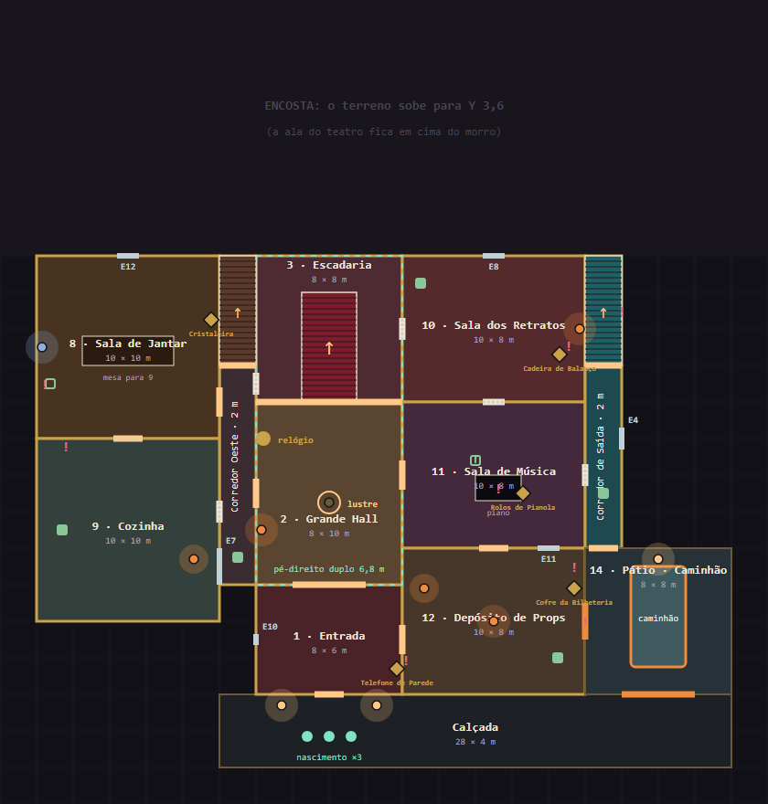
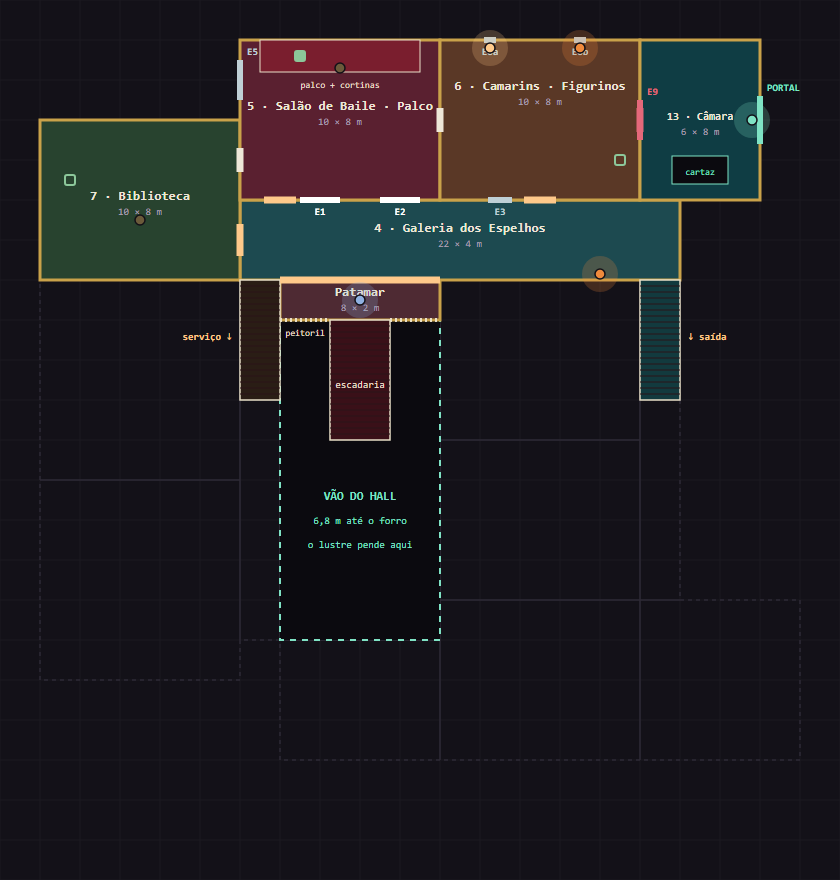
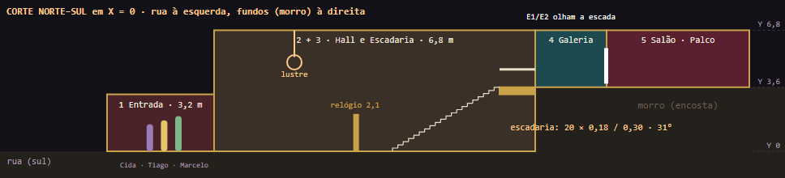

# Planejamento — Fase 1 V1.2: a Mansão do Espelho

Planejamento de direção (espaço, jogo, som e arte) da **nova planta da Fase 1**, feito a partir da
documentação "Mansão do Espelho" (V1) e o mais perto possível da arte de referência.
**Nada aqui está implementado.** A Casa do Espelho que está hoje no Unity continua como está e
será ajustada a este documento quando a implementação começar (§14).

| Fonte | Onde está |
|---|---|
| Art Bible da fase (pranchas desenhadas: plantas, corte, fichas, espelhos, ritmo, kit, riscos) | [Art Bible · Fase 1 · A Mansão do Espelho](https://claude.ai/artifact/TqLD6yDYTxboC8wwv89ivw) |
| Documentação recebida (PDF, arte de referência, CSV, JSON) | [Art/Source/Environment/MansaoFase1/referencia/](Art/Source/Environment/MansaoFase1/referencia/) |
| Plantas e corte (SVG e PNG) | [Art/Source/Environment/MansaoFase1/plantas/](Art/Source/Environment/MansaoFase1/plantas/) |
| A planta em dados + as checagens | [tools/level/mansao_v1_2.py](tools/level/mansao_v1_2.py) e [planta_svg.py](tools/level/planta_svg.py) |
| Level design da Casa do Espelho atual (família Taborda, mecânicas, sons) | [LEVEL_DESIGN_FASE1.md](LEVEL_DESIGN_FASE1.md) |

---

## 1. Resumo

- **Os 14 ambientes da arte, em dois níveis, numa casa na encosta.** Os fundos (biblioteca, salão
  com palco, camarins, câmara secreta) ficam em cima do morro, em Y 3,6.
  - A escadaria nobre sobe do hall até a Galeria dos Espelhos.
  - A galeria faz um L e **desce pelo lado leste até a saída** (o corredor azul da arte).
  - Nada flutua e não sobra nenhum volume morto embaixo.
- **1.092 m² internos**, numa pegada de 38 × 36 m, com três escadas e seis anéis de circulação.
- **A casa é escura de verdade.** A lanterna é a luz da noite e as pilhas são disputadas (§6).
- **O piano é a trilha.** O piano da Sala de Música é uma **pianola** que toca sozinha; a trilha
  de fundo vem dela (§7).
- **Objetos de 1927:** 14 entregas da lista do chefe, com nomes e peças da época, e 12 **achados
  de época** de bônus (§8).
- **A casa reage a quem passa:** livros caem da estante, pratos quebram, quadros despencam, teias
  rasgam (§9).
- **As decisões D1 a D14 foram aprovadas em 27/10/2026** (§13). Só o acabamento (D9) segue em aberto.

## 2. O material recebido

| Arquivo | O que tem |
|---|---|
| `documentacao_mansao.pdf` | visão geral, plantas do térreo e do superior, função de cada ambiente, convenções Blender → Unity, critérios de validação |
| `imagem_referencia.jpeg` | vista isométrica da casa inteira, com os 14 ambientes numerados, props, espelhos, pistas e perigos |
| `salas_mansao_coordenadas.csv` / `mansao_layout_unity.json` | 18 cômodos no grid de 2 m (o CSV dá o canto, o JSON dá o centro; os dois batem) |

**O que não fechava nos dados**, medido com script:
- O CSV põe tudo no térreo; o PDF põe 4, 5, 6, 7 e 13 em cima.
- A Câmara Secreta não encostava em nada e sobrepunha os Camarins.
- Jantar, Cozinha e Biblioteca ficavam a 4 m do hall, sem passagem.
- O Depósito estava a oeste; a arte e o PDF o põem a leste, ao lado do caminhão.
- U2 a U4 ficavam fora da pegada do térreo.
- Não havia nenhum anel de circulação.

## 3. Como a arte foi lida

1. **Hall e escadaria no eixo.** Do portão ao pé da escada é uma linha reta de 16 m: tapete
   vermelho, piso xadrez e o lustre por cima. (Na arte o relógio fica no eixo; no jogo ele vai para
   a parede oeste do hall, para não travar o armário descendo a escadaria.)
2. **A Galeria dos Espelhos é um L.** Atravessa os fundos no alto da escadaria e desce pelo lado
   leste até a saída.
3. **O teatro fica atrás da galeria:** biblioteca, salão com palco, camarins e câmara, no nível de cima.
4. **Há corredores entre as alas.** A arte mostra uma passagem estreita, com um espelho, entre o
   hall e o jantar.
5. **O depósito fica na frente, à direita**, ao lado do pátio do caminhão.
6. **A câmara fica no canto nordeste**, colada aos camarins.
7. **O caminhão fica no pátio, fora da casa**, com duas rotas até ele.

A arte junta os dois andares numa vista só. **A casa na encosta** é o que permite construir isso
em 3D.

## 4. A planta V1.2

**Coordenadas:**
- origem no eixo do hall;
- X leste, Z norte (fundos), Y para cima;
- grid de 2 m;
- térreo em Y 0, pé-direito 3,2 m, laje de 0,4 m;
- nível de cima em **Y 3,6 m**, sobre o morro a partir de Z 7;
- hall e escadaria formam um só volume de **6,8 m**.

### 4.1 Cômodos

| # | Cômodo | Nível | X | Z | Tamanho |
|---|---|---|---|---|---|
| — | Calçada e escadas da frente | exterior | −6..22 | −21..−17 | 28 × 4 |
| 1 | Entrada / Spawn | térreo | −4..4 | −17..−11 | 8 × 6 |
| 2 | Grande Hall + Relógio | térreo, 6,8 m | −4..4 | −11..−1 | 8 × 10 |
| 3 | Escadaria (+ patamar em Y 3,6, Z 5..7) | térreo, 6,8 m | −4..4 | −1..7 | 8 × 8 |
| — | Corredor Oeste | térreo | −6..−4 | −11..1 | 2 × 12 |
| — | Escada de Serviço (poço) | térreo, 6,8 m | −6..−4 | 1..7 | 2 × 6 |
| 8 | Sala de Jantar | térreo | −16..−6 | −3..7 | 10 × 10 |
| 9 | Cozinha | térreo | −16..−6 | −13..−3 | 10 × 10 |
| 10 | Sala dos Retratos | térreo | 4..14 | −1..7 | 10 × 8 |
| 11 | Sala de Música | térreo | 4..14 | −9..−1 | 10 × 8 |
| 12 | Depósito de Props | térreo | 4..14 | −17..−9 | 10 × 8 |
| — | Corredor de Saída | térreo | 14..16 | −9..1 | 2 × 10 |
| — | Galeria Leste (descida, poço) | térreo, 6,8 m | 14..16 | 1..7 | 2 × 6 |
| 14 | Saída / Caminhão (pátio) | exterior | 14..22 | −17..−9 | 8 × 8 |
| 4 | Galeria dos Espelhos | cima | −6..16 | 7..11 | 22 × 4 |
| 7 | Biblioteca | cima | −16..−6 | 7..15 | 10 × 8 |
| 5 | Salão de Baile / Palco | cima | −6..4 | 11..19 | 10 × 8 |
| 6 | Camarins / Figurinos | cima | 4..14 | 11..19 | 10 × 8 |
| 13 | Câmara Secreta do Espelho | cima | 14..20 | 11..19 | 6 × 8 |

U1 virou o patamar. U2 a U4 ficam fora do V1 (D7).
As duas escadas de serviço ficam num **poço** de pé-direito duplo (6,8 m): com o forro do
corredor por cima, quem sobe bateria a cabeça na laje.

### 4.2 Portas

Simples 1,2 × 2,4 · dupla 1,6 × 2,4 · arco de 4 m (entrada → hall) · carga 2,0 (depósito → pátio) ·
portão de 4 m (calçada → pátio). A porta Salão ↔ Camarins é a **coxia** (simples).
A porta Escadaria ↔ Corredor Oeste fica em Z 0 (em Z 3 ela abria em cima da rampa da escada de serviço).
O **E9** é o espelho-porta Camarins ↔ Câmara (§5.3). A lista completa, com as posições, fica em
`D` no `mansao_v1_2.py`.

### 4.3 As três escadas

| Escada | Largura | Medida | Papel |
|---|---|---|---|
| **Nobre** | 3,0 m | 20 degraus de 0,18 × 0,30, **31°**, sobe para o norte no eixo do hall | rota dos móveis de dupla; palco da aparição |
| **Serviço oeste** | 2,0 m | idem, no fim do Corredor Oeste, chega à ponta oeste da galeria | escada da criadagem: **só para leves** (D4) |
| **Galeria Leste** | 2,0 m | idem, desce da ponta leste da galeria até o corredor de saída | o caminho mais curto dos camarins ao caminhão (33 m) |

### 4.4 Checagens (`python tools/level/mansao_v1_2.py`)

- **Sobreposição:** nenhuma.
- **Portas:** todas ficam numa parede comum aos dois cômodos.
- **Apoio:** todo o nível de cima está sobre o morro ou sobre a escadaria.
- **Distância andando até o caminhão:**
  - Depósito 9 m · Galeria Leste 13 m · Música 14 m · Entrada 18 m · Retratos 20 m · Hall 21 m
  - Cozinha 32 m · Galeria 32 m · Camarins 33 m · Jantar 36 m · Câmara 39 m · Salão 41 m · Biblioteca 43 m

## 5. Como a casa serve o jogo

> **Embaixo, a casa onde a família vivia. Em cima, o teatro onde ela fingia. A escadaria é o
> palco entre os dois — e todo móvel de cima desce por ela.**

### 5.1 Anéis

| Anel | Percurso |
|---|---|
| A · volta grande oeste | Hall → escadaria ↑ → galeria → serviço ↓ → Corredor Oeste → Hall |
| B · volta grande leste | Hall → escadaria ↑ → galeria → Galeria Leste ↓ → Música → Hall |
| C · térreo leste | Hall → Música → Retratos → escadaria → Hall |
| D · carga | Entrada → Depósito → Pátio → Galeria Leste → Música → Hall → Entrada |
| E · teatro | Galeria → Salão → coxia → Camarins → Galeria |
| F · criadagem | Corredor Oeste → Cozinha → Jantar → Corredor Oeste |

O único beco é a Câmara Secreta.

### 5.2 Ambientes

As fichas completas, com função, sentido que lê o cômodo, âncora, espelhos, móveis, luz e pista,
estão nas pranchas 03 e 04 do Art Bible da fase. O resumo de cada cômodo:

| Cômodo | Âncora sonora | Peça-chave |
|---|---|---|
| Calçada | rádio chiando | bilhete nº 014 na porta |
| Entrada | — | nota fiscal "remoção de entidade — R$ 0,00"; telefone de parede |
| Grande Hall | **relógio de pêndulo** (o metrônomo da casa) | lustre (só acende na aparição) |
| Escadaria | degrau rangendo ao carregar | E1/E2 de frente para quem sobe |
| Corredor Oeste | — | E7, o espelho da arte entre hall e jantar; campainhas de serviço |
| Jantar | lustre de cristal tilintando | mesa posta para 9, um lugar sem talher; cristaleira |
| Cozinha | torneira pingando | fogão a lenha, talha de barro, pratos empilhados |
| Retratos | vento na janela de tábuas | 7 retratos da Herondina; E8 numa moldura de retrato; cadeira de balanço |
| Música | **a pianola** (§7) | rolos de pianola |
| Depósito | lona batendo na porta de carga | caixas "TABORDA & CIA · CENÁRIOS", cofre da bilheteria |
| Galeria Leste | tábua solta rangendo | retratos com o rosto raspado |
| Pátio | **caminhão em marcha lenta** (`caminhao_motor`, hoje sem uso) | lanternas no estribo |
| Patamar | vento pela clarabóia | — |
| Galeria | arandela a gás (fonte de ruído nº 3) | tapete corrido mudo; 3 manequins (um tomba aos 2:40) |
| Biblioteca | só o rangido do piso | estante que derruba livros; máquina de escrever |
| Salão | gramofone travado (fonte de ruído nº 1) → cortina | palco com cortinas vermelhas; 4 manequins; espelho de pé |
| Camarins | cabides da arara | armário, penteadeira, arara; o **E9** |
| Câmara | nenhuma (o zumbido do portal) | portal ciano; o cartaz de 1927 |

### 5.3 Espelhos

| # | Onde | Papel |
|---|---|---|
| **E1, E2** | galeria, de frente para a escadaria, a 4 m um do outro | **heróis** (reflexo de verdade). A aparição sai do E1 e volta pelo E2 |
| E3 | galeria, diante dos camarins | esconderijo |
| E4 | Galeria Leste | esconderijo |
| E5 | Salão (espelho de ensaio) | esconderijo |
| E6a, E6b | Camarins (penteadeiras, a 4,5 m) | esconderijo |
| E7 | Corredor Oeste | esconderijo |
| E8 | Retratos (numa moldura de retrato) | esconderijo; o "retrato que se mexe" |
| E10, E11, E12 | Entrada, Música, Jantar | esconderijo |
| **E9** | Camarins, parede leste | espelho-porta; **não é esconderijo** |
| **Portal** | Câmara, parede leste, GG 2,4 m, ciano | a casa dele; gatilho próprio; **não entra no rodízio** |

**Regra:** espelhos a pelo menos 4 m um do outro (ver o risco R09).

**Cuidado com os números:** a numeração E1–E12 é desta casa. Ela não corresponde aos espelhos
E1–E7 da Casa do Espelho atual ([LEVEL_DESIGN_FASE1.md](LEVEL_DESIGN_FASE1.md) §7.3).

**A Câmara:** no diapasão, o E9 soa **oco**. A Cida segura "Afinar" por 2 s, a passagem se revela,
e então qualquer um pode "Empurrar". Plano B sem a Cida na partida: o E9 já começa rachado e
qualquer um empurra (D5).

## 6. Escuro, lanterna e teias

A arte tem muitas luzes acesas. **No jogo, a casa é bem mais escura.** O Art Bible pede luz
ambiente perto de zero, e a luz principal é a das **lanternas** (3200 K). A lanterna tem que ser
vital do começo ao fim.

### 6.1 As luzes que existem (15 pontos, o resto é breu)

São os pontos da lista `LUZES` no `mansao_v1_2.py`, marcados nas plantas.

| Estado | Onde |
|---|---|
| **Acesas** (4) | lampiões do portão ×2, faróis do caminhão, uma lâmpada de camarim |
| **Falhando** (5) | arandela do hall, arandela dos retratos, lâmpada nua do depósito, arandela da galeria (fonte de ruído: afinada, apaga), uma lâmpada de camarim |
| **Apagadas** (3) | o lustre do hall e o refletor do palco (só acendem na aparição); a luminária verde da biblioteca (acender faz um clique de 6 m) |
| **Luar** (2) | janela do jantar; clarabóia do patamar |
| **Ciano** (1) | o portal da Câmara |

Cozinha, Música, Salão, Corredor Oeste, Galeria Leste e Entrada **não têm luz nenhuma**.
As **velas** (pilares da escadaria, salão) são só chama: não iluminam e apagam com quem passa
correndo. Os 2 lampiões de querosene (§6.2) são luz que se carrega e não entram na conta dos 15.
As luzes acesas são **portos seguros** quentes: é para lá que o grupo volta.

### 6.2 A economia da luz (o que já existe, recalibrado)

- **Lanternas:** 2 no estribo do caminhão para 3 pessoas (já existe; a Cida diz "Não preciso.").
- **Bateria:** 100 s de luz; abaixo de 20% começa a falhar; em 0 apaga (já existe).
- **Pilhas:** recarregam 40% (40 s). São **10 na casa**, marcadas nas plantas:
  - **6 fixas, à vista:** cozinha, Corredor Oeste, retratos, depósito, palco, Galeria Leste.
  - **4 escondidas**, que só aparecem com um evento: na gaveta do aparador do jantar (abre
    sozinha), atrás da banqueta da pianola, entre os livros que caem da estante, num bolso de
    casaco da arara.
- **A conta:**
  - Duas lanternas ligadas em ~70% da noite pedem **~460 s de luz**.
  - Há 200 s de bateria, mais 400 s se acharem as 10 pilhas, o que dá 600 s.
  - Achando dois terços das pilhas, a luz **fica no limite**: quem não procura pilhas fica no escuro na corrida final.
- **Lampião de querosene ×2** (cozinha e depósito) (D12):
  - Dá uma luz quente de 4 m que **ocupa as duas mãos**: quem leva o lampião não carrega móvel.
  - Deixado no chão, vira um porto seguro que a equipe monta onde quiser.
  - Não acaba.

### 6.3 Teias (o abandono)

- **Teias de canto** (o modelo `Teia` já existe): cantos de teto, lustres, balaústres, molduras.
  É só decoração, mas está em todo cômodo.
- **Teias de vão:** ~8 portas e passagens pouco usadas começam fechadas por teia.
  - Quem passa rasga a teia (som curto, 2 m), e ela fica rasgada (estado de rede).
  - **A pista:** o Imitador flutua e **atravessa sem rasgar**. Uma teia inteira num vão por onde
    "alguém" acabou de passar quer dizer que foi ele. É uma leitura do Tiago (visão), e fica
    melhor com a lanterna.
- **Lençóis sobre os móveis, poeira no chão e papel de parede descascando:** já existem como
  modelo e se espalham pela casa inteira.

## 7. A trilha é o piano

A trilha da casa já é um piano sombrio (`trilha_casa_espelho`). A proposta é usá-lo **muito**, e
dar a ele um corpo na casa.

**O piano da Sala de Música é uma pianola** (piano de rolo, moda nos anos 1920). Toca sozinho
porque tem um rolo dentro. É de onde a trilha "vem".

| Camada | O que é | Como toca |
|---|---|---|
| **1 · Leito** | `trilha_casa_espelho` em loop, baixo | 2D, a noite inteira (já existe no `SoundDirector`: leito, vácuo, pânico, alívio) |
| **2 · A pianola** | a **mesma faixa**, sincronizada com o leito, saindo da pianola em 3D | perto da Sala de Música (~10 m), a trilha deixa de ser "música" e vira o piano de verdade, no espaço. O Tiago vê a pianola vibrar |
| **3 · Frases de cena** | frases curtas de piano disparadas por momentos | aparição: um glissando que **desce junto com ele** pela escadaria · etapa nova: um tema curto · captura: um acorde grave · âmbar: o tema volta mais rápido · amanhecer: um acorde maior, a **única** vez na noite |
| **4 · O piano errado** | `piano_tocado` e `piano_desafinado_acorde` (já existem) | quando um móvel carregado passa pela Música, a pianola acorda (já existe) |
| **5 · O silêncio** | o piano **para** | na Câmara Secreta e no pânico. O susto é a falta dele |

**Afinar a pianola (Cida)** tira só o acorde desafinado (o ruído que borra o eco). **A melodia
continua**, mais limpa. Isso muda o comportamento de hoje: hoje, afinar desliga a fonte inteira.

**Rolos de pianola** são um achado de época. Tirar a caixa de rolos da sala **não para a
pianola**. Ela continua tocando.

Sons novos de piano: `piano_glissando_descida`, `piano_tema_etapa` (×3), `piano_acorde_captura`,
`piano_acorde_amanhecer`, `pianola_mecanismo` (o fole e os pedais rangendo, loop 3D baixo),
`piano_tampa_bate`.

## 8. Objetos de 1927

A companhia **Taborda & Cia — Grande Elenco** (teatro de revista) morava aqui em 1927. Os objetos
contam isso.

### 8.1 A lista do chefe (objetivo · 14 entregas)

| # | Móvel | De | Peso | Quem leva |
|---|---|---|---|---|
| 1–2 | Cadeira austríaca de palhinha ×2 | Jantar | 1 | qualquer um |
| 3 | Talha de barro (frágil) | Cozinha | 1,5 | Tiago ou Marcelo |
| 4 | Caixa de figurinos | Depósito | 1 | qualquer um |
| 5 | Caixa de cenário G | Depósito | 2 | Marcelo ou dupla |
| 6 | Baú-camarim de turnê | Depósito | 2 | Marcelo ou dupla |
| 7 | Poltrona coberta | Retratos | 2 | Marcelo ou dupla |
| 8 | Banqueta da pianola | Música | 1 | qualquer um |
| 9 | Mesa de leitura | Biblioteca | 2,5 | Marcelo ou Cida + Tiago |
| 10 | Cadeira de plateia | Salão | 1 | qualquer um |
| 11 | Armário de figurino | Camarins | 3,5 | só o Marcelo + alguém |
| 12 | Penteadeira de camarim | Camarins | 2,5 | Marcelo ou Cida + Tiago |
| 13 | Arara de figurino | Camarins | 1,5 | Tiago ou Marcelo |
| 14 | **Cartaz de 1927** (relíquia) | Câmara | 2 | Marcelo ou dupla |

### 8.2 Achados de época (bônus · D10)

Fora da lista do chefe. Valem **pagamento extra**, e o Seu Valdemar comenta os que vierem.
Cada um tem um susto ou uma pista.

| Achado | De | Peso | O que ele faz |
|---|---|---|---|
| Cristaleira | Jantar | 3 · frágil | o vidro tilinta enquanto é carregada (ruído de 6 m) |
| Telefone de parede de manivela | Entrada | 1 | toca **uma** vez, perto dos 2:00. Atendido, ninguém fala do outro lado, só uma pianola ao longe |
| Cadeira de balanço de palhinha | Retratos | 1,5 | balança sozinha quando ninguém olha |
| Rolos de pianola (caixa) | Música | 1 | tirados da sala, a pianola continua tocando |
| Cofre da bilheteria | Depósito | 3,5 | só o Marcelo + alguém; dentro está o borderô da última sessão, com o Valdemar no elenco |
| Máquina de escrever | Biblioteca | 1 | as teclas batem sozinhas e escrevem "SUPLENTE" |
| Lanterna mágica (projetor de vidro) | Biblioteca | 1 · frágil | ligada, projeta na parede uma lâmina da companhia com um rosto riscado |
| Gramofone de corneta | Salão | 1,5 | só pode ser levado depois de afinado |
| Refletor de palco | Salão | 2 | acende sozinho na aparição, apontado para a escadaria |
| **Espelho de pé (psiché)** | Salão | 2 · frágil | **o Imitador pode entrar no espelho que alguém está carregando** (D11) |
| Máquina de costura de pedal | Camarins | 2,5 | o pedal range sozinho |
| Biombo de camarim | Camarins | 1,5 | esconde quem está atrás dele (visão) |

**Frágil** (D13): bater faz barulho e dá desconto no bilhete do chefe; nada quebra de vez.

## 9. A casa reage: coisas que caem

A casa responde a quem passa por ela: **esbarrou, caiu**. É terror de proximidade, que funciona
para os três sentidos (som para a Cida, anel de vibração para o Tiago, movimento para quem enxerga).

**A mecânica** (generaliza o `TimedTopple`, que hoje derruba o manequim por tempo):
- **O que dispara a queda:**
  - alguém correndo a menos de 1,5 m;
  - um móvel carregado batendo no volume;
  - passar perto (com uma chance, uma vez);
  - um evento da noite.
- **Quem decide:** o **host** decide e todos tocam a mesma animação (sem física em rede).
- **O que a queda emite:**
  - som 3D e evento de som (`Impact`), que borra o eco e faz anel;
  - aviso por sentido (`GameCue`);
  - às vezes, larga uma **pilha escondida**.
- **Regras do susto:**
  - no máximo **um a cada 20 s** na casa;
  - nenhum durante o pânico do `SoundDirector`;
  - cada um acontece **uma vez por noite** (a estante, duas).

| Onde | O que cai | Gatilho | Som (alcance) |
|---|---|---|---|
| Biblioteca | **4 a 6 livros da estante** (um larga uma pilha) | esbarrar correndo ou com móvel | `livros_caem` (10 m) |
| Cozinha | pilha de pratos | móvel bate na bancada | `pratos_quebram` (12 m), eco borrado por 3 s |
| Galeria Leste | um retrato despenca, o vidro trinca | alguém desce carregando | `quadro_cai` (9 m) |
| Jantar | o lustre balança e tilinta | alguém passa por baixo carregando | lustre (7 m) |
| Depósito | caixa do alto da pilha | passar perto (1×) | `caixa_despenca` (10 m) |
| Retratos | a cadeira de balanço balança | ninguém olhando para ela | `cadeira_balanco` (5 m) |
| Música | a tampa da pianola bate | passar correndo | `piano_tampa_bate` (10 m) |
| Jantar | a gaveta do aparador abre (larga uma pilha) | evento, ~1:30 | `gaveta_abre` (5 m) |
| Entrada | o telefone de parede toca | evento, ~2:00 | `telefone_manivela` (14 m) |
| Hall | a porta da entrada bate | a porta de carga abre (corrente de ar) | `porta_bate` (12 m) |
| Salão e hall | velas apagam | alguém passa correndo | `vela_apaga` (2 m) |
| Galeria | manequim tomba (já existe) | 2:40 | `manequim_tomba` |
| Vãos com teia | a teia rasga | alguém passa | `teia_rasga` (2 m) |

## 10. Logística e ritmo (330 s)

**Conta da lista do chefe:**
- **Trajetos somados:** ~387 m.
- **Tempo de trabalho:** ~320 jogador-segundos.
- **Com 3 jogadores:** ~110 s de relógio, se tudo fosse perfeito.
- **Com a vida real:** ~250 a 300 s, contando exploração, a câmara, afinar, ser pego, pilhas e escuro.
- **Noite proposta:** **330 s**, com o âmbar aos 4:08.
- **Achados de época:** são bônus e não entram na conta. Quem vai atrás deles troca tempo por pagamento.

| Tempo | Momento |
|---|---|
| −0:15 | O rádio lê o bilhete na calçada; o caminhão está em marcha lenta no pátio |
| 0:00 | **Etapa 1 · "Esvaziar o térreo"** (8 entregas); o leito de piano começa baixo |
| 0:45 | **A aparição:** o Imitador desce do E1 pela escadaria, o refletor e o lustre acendem e o glissando desce com ele. Reverência; volta pelo E2 |
| ~1:10 | A pianola acorda (um móvel passa pela Música) |
| ~1:30 | A gaveta do jantar abre sozinha (pilha) |
| ~1:50 | **Etapa 2 · "A ala do teatro"** (5 entregas): duplas descendo diante de E1/E2 |
| ~2:00 | O telefone toca |
| ~2:20 | A isca na escadaria ou na Galeria Leste |
| ~2:40 | O manequim tomba na galeria |
| ~3:10 | **Etapa 3 · "O cartaz"**: o E9 soa oco no diapasão |
| ~3:30 | A Câmara: o piano **para** |
| 4:08 | Âmbar; o tema volta mais rápido; as pilhas já estão no fim |
| ~5:00 | A última reverência; ele sai ofendido pelo portal |
| 5:30 | Amanhecer: o acorde maior; avaliação |

## 11. Kit e modelos

| | Peças |
|---|---|
| **Já existe** (só muda de lugar) | relógio, lustre, piano de armário, armário, penteadeira, arara, mesa de leitura, estante, pilha de livros, luminária verde, gramofone, manequins, retratos, caixas, baú, móveis cobertos, molduras S/M/L e rachada, arandela, clarabóia, tábua solta, caminhão, rádio, cartaz, torneira, velas, **teia**, entulho, **lanterna, pilhas** |
| **Muda** (parâmetro no script) | paredes de 3,2 m (lisa, porta, dupla) · laje de 0,4 · escadaria de 3 m com 20 degraus · escadas de 2 m · mesa de jantar própria · penteadeira com lâmpadas · moldura do E9 que abre · piano de armário → **pianola** (frente com o rolo à mostra) |
| **Novo: cenário** | portal GG 2,4 ciano · arco de 4 m · porta de carga · palco com cortinas · janela · muro de arrimo e encosta · calçada, pátio, grade, portão · lampião externo · árvore e arbusto · teia de vão (rasgável) |
| **Novo: época** | cadeira austríaca de palhinha · talha de barro · cristaleira · telefone de parede · cadeira de balanço · rolos de pianola · cofre da bilheteria · máquina de escrever · lanterna mágica · refletor de palco · espelho de pé (psiché) · máquina de costura de pedal · biombo · lampião de querosene · fogão a lenha · bancada · pratos empilhados · aparador com gaveta |

## 12. Pontas soltas e bugs esperados

"Confirmado" quer dizer lido no código de hoje; "a medir" quer dizer que precisa ser conferido em
Play ou em batch. Bug novo vira teste antes da correção (regra de TDD do projeto).

| # | Peso | O que vai acontecer | Por quê | Como evitar |
|---|---|---|---|---|
| R01 | **trava** · confirmado · ✅ tratado | sem a Cida, a Câmara nunca abre | "Afinar" o E9 é só dela | plano B: o E9 começa rachado e qualquer um empurra |
| R02 | **trava** · confirmado | sem o Marcelo, o armário (3,5) não sai | Cida + Tiago = 2,5 | o objetivo conta só o que a equipe consegue levar; o armário vira bônus com 2 jogadores |
| R03 | alto · confirmado · ✅ tratado | o Imitador puxa alguém do térreo para um espelho de cima (ou sai de cima para pegar alguém embaixo) | `GhostHideout.Nearest`/`Farthest` medem distância em linha reta | escolher pelo comprimento do caminho no NavMesh (`CalculatePath`), numa regra pura com teste |
| R04 | alto · confirmado · ✅ tratado | o reflexo "pula" entre espelhos na galeria | `MirrorReflection` liga os 2 mais perto e na tela (até 12 m) | prioridade fixa para E1/E2 (campo "herói") |
| R05 | alto · a medir | o Imitador não sobe ou fica preso no pé de uma escada | 3 escadas = 6 pontas; pé estreito isola | `NavMeshLink` nas 6 pontas + script temporário com `CalculatePath` |
| R06 | alto · a medir | o armário trava na curva da escada de serviço | 1,0 m de móvel, duas cápsulas, 90° em 2 m | escada de serviço só para leves (D4) |
| R07 | médio · confirmado | a bengala no térreo desenha os cômodos de cima através do morro | o eco usa distância 3D | aceitar, ou um limite de altura no shader fora do vão do hall |
| R08 | médio · a medir | âncoras e a pianola vazam por paredes | áudio sem oclusão | calibrar alcances pela planta; teste de olhos fechados |
| R09 | médio · confirmado · ✅ tratado | dois espelhos acendem juntos para a Cida | ocupado = Imitador a < 1,5 m da saída (e < 2,5 m na vertical) | ≥ 4 m entre espelhos |
| R10 | médio · confirmado · ✅ tratado | "caiu no Grande Hall" para quem caiu no patamar | o `Room` do hall tem 6,8 m de altura | caixas por andar |
| R11 | médio · a medir | portas de cima prendem o fantasma | folga de 10 cm some no arredondamento | medir cada porta no script temporário |
| R12 | médio · confirmado · ✅ tratado | no perfil Mobile, as luzes somem | PC usa Forward+; Mobile usa Forward com 4 luzes por objeto | a casa escura tem só 15 pontos; manter assim |
| R13 | médio · a medir · ✅ tratado | o portal puxa quem só entrou para pegar o cartaz | regra nova | "sozinho" = ninguém a 6 m por 4 s, com aviso, e só depois de tocar no cartaz |
| R14 | baixo · confirmado · ✅ tratado | a noite acaba antes da casa | a ficha diz 300 s | 330 s (D6) + playtest |
| R15 | baixo · a medir | jogadores saem pela calçada para o fundo e sobem o morro | a encosta é exterior aberto | grade e portão fecham a calçada; o morro tem colisão e nenhum caminho |
| R16 | baixo · a medir | a aparição desce a escadaria aos tropeços | hoje ele anda pelo NavMesh até o "Palco do Imitador" a 1,2 m/s; a escadaria tem 31° | agente com inclinação ≥ 35° e degrau de 0,18; o palco fica debaixo do lustre |
| R17 | baixo · confirmado · ✅ tratado | o E9 e o portal viram esconderijo | todo `Mirror` entra no rodízio (`Hop`/`OtherMirror`) | outro tipo, ou uma marca "não esconder" |
| R18 | médio · a medir · ✅ tratado | a pianola 3D e o leito saem de sincronia | duas `AudioSource` com a mesma faixa | a pianola copia o `timeSamples` do leito ao entrar no alcance |
| R19 | médio · a medir · ✅ tratado | os livros caídos ficam em lugares diferentes em cada tela | física local | animação decidida pelo host; livros caídos são só visual e não bloqueiam a passagem |
| R20 | médio · a medir · ✅ tratado | sustos demais viram ruído | 13 quedas + o telefone + o Imitador + o diretor de som | um susto a cada 20 s no máximo, pelo mesmo `SoundDirector`; nenhum no pânico |
| R21 | baixo · a medir | a luz acaba cedo demais (ou nunca acaba) | economia nova: 2 lanternas, 10 pilhas, 2 lampiões | playtest: anotar a carga média das lanternas na hora do âmbar |
| R22 | baixo · a medir | o espelho de pé carregado vira esconderijo sem regra | mecânica nova (D11) | só com alguém carregando há mais de 3 s, fora do pânico, no máximo 1 vez por noite |
| R23 | baixo · a medir · ✅ tratado | o Imitador rasga teias e estraga a pista | teia de vão é regra nova; ele flutua | só jogadores rasgam teia (o host confere quem passou) |

## 13. Decisões

**Aprovadas em 27/10/2026:**

| # | Decisão |
|---|---|
| D1 | Casa na encosta: o teatro fica em cima do morro (Y 3,6) |
| D2 | Pé-direito 3,2 m; nível de cima em Y 3,6; hall e escadaria com 6,8 m |
| D3 | Galeria em L, com descida a leste até a saída |
| D4 | Escada de serviço oeste só para leves |
| D5 | Câmara atrás do E9, achada pelo diapasão, com plano B sem a Cida |
| D6 | Noite de 330 s e 14 entregas (revisar no 1º playtest) |
| D7 | U2 a U4 fora do V1 |
| D8 | A mansão substitui a Casa do Espelho (mesma cena), combinando com o time |
| D9 | Acabamento (low-poly × PBR) continua em aberto; não bloqueia o blockout |

**Acréscimos, também aprovados em 27/10/2026:**

| # | Decisão |
|---|---|
| D10 | Achados de época são **bônus** (pagamento + comentário do chefe); não mexem na conta de 330 s |
| D11 | O Imitador **pode entrar** no espelho de pé que alguém está carregando, como mecânica B (depois da casa pronta) |
| D12 | Lampião de querosene: luz que **ocupa as mãos** e vira porto seguro no chão |
| D13 | Frágil = **só som e desconto** no bilhete; nada quebra de vez |
| D14 | Afinar a pianola tira **só o acorde desafinado**; a melodia continua (muda o "Afinar" atual do piano) |

## 14. Ordem de implementação

| Etapa | O quê | Situação |
|---|---|---|
| **1 · A casa** | kit de 3,2 m e as 3 escadas no Blender; a planta em dados gera paredes, pisos, lajes e móveis; a cena montada do JSON (`MirrorHouseBuilder.Mansao.cs`); NavMesh nos dois níveis; caminhão, nascimento, as 14 entregas e as 3 etapas; luzes e pilhas fixas | **feita em 27/10/2026** · medida em batch, **não testada com Play** |
| **2 · Os espelhos e o Imitador** | 14 espelhos (E1/E2 heróis), o E9 (`SecretMirrorDoor`, com plano B), o portal (`PortalTrap`), a aparição descendo a escadaria com o lustre e o refletor acendendo (`AppearanceLights`), o espelho escolhido pelo caminho (`MirrorPaths`), as 3 fontes de ruído, 9 âncoras, 3 pisos que rangem, o abandono e as teias de canto | **feita em 27/10/2026** · 130 testes EditMode passando (18 novos) · medida em batch, **não testada com Play** |
| **3 · Atmosfera e época** | a pianola (a trilha em 3D, sincronizada) e as frases de piano; a casa reage (16 quedas, toques e balanços, `HouseScare`); 8 teias de vão (`DoorWeb`); 4 pilhas escondidas; 2 lampiões; a luminária verde; 10 achados de época com pagamento extra e 4 frágeis com desconto; 19 modelos e 21 sons novos | **feita em 27/10/2026** · 146 testes EditMode e 3 de fumaça passando · medida em batch, **não testada com Play** |

**Como a Etapa 1 foi medida** (script temporário em batch):
- **Rotas:** o nascimento chega a pé, pelo NavMesh, aos 20 cômodos (de 5 a 45 m), e cada um dos 14 móveis tem rota até o caminhão (de 7 a 42 m).
- **Portas:** o Marcelo (1,98 m) passa nas 19; o armário (1,0 × 2,0) passa nas 11 duplas.
- **Escadas:** as 3 chegam em 3,60 m, sem degrau maior que 6 cm e sem bater a cabeça.
- **Caminhão:** a zona de entrega fica dentro do pátio.

**Como a Etapa 2 foi medida:**
- **Testes:** os 130 testes EditMode passam, 18 deles novos (`MansionRulesTests`).
- **Espelhos:** as saídas dos 12 espelhos de esconderijo são alcançáveis a pé, e há 2 heróis.
- **R03 na cena:** da Biblioteca, o espelho mais perto em linha reta é o E12, no jantar lá embaixo, a 7 m; andando, é o E1, a 13 m.
- **E9:** fechado, ele fecha a Câmara para o fantasma; aberto, deixa 5 m de passagem (Câmara a 47 m do nascimento).
- **Portal:** está ligado ao cartaz.
- **Cenário:** nada encosta em parede nem fecha porta, e todas as rotas da Etapa 1 continuam.

**O que a Etapa 2 mudou:**
- **Refletor da aparição:** fica no patamar, apontado para o palco debaixo do lustre; no salão, ele não iluminaria a escadaria.
- **E12:** foi para o aparador da parede norte do jantar, porque na parede oeste ficava em cima da janela.
- **Obstáculos no bake:** o bake do NavMesh desliga os obstáculos (`LevelSceneTools`). Ligados, eles gravavam um buraco permanente onde cada móvel nasce, e o E9 aberto continuaria fechado para o fantasma. Vale para todas as fases.

**Como a Etapa 3 foi medida:**
- **Testes:** os 146 testes EditMode passam, 16 deles novos (`AtmosphereRulesTests`); os 3 de fumaça (Play Mode) também.
- **Cena:** 16 sustos, 8 teias, 10 achados, 4 frágeis (a talha e 3 achados), a pianola e a luminária.
- **Pilhas escondidas:** cada uma das 4 tem quem a revele (a gaveta, os livros da estante oeste, a banqueta e a arara).
- **Quedas:** tudo o que cai tem chão debaixo (os pratos caem 0,9 m, o retrato cai 1,4 m na rampa da Galeria Leste).
- **Rotas:** os 26 móveis (14 da lista, 10 achados, 2 lampiões) têm rota do nascimento e até o caminhão, de 6 a 44 m.
- **Teias:** as 8 ficam no vão livre da porta, e a porta continua passável.
- **Sons:** os 21 sons novos (26 arquivos) estão no `Sons.asset`.
- **Fotos:** cozinha, jantar, biblioteca, camarins, retratos (a teia na porta) e salão, renderizadas em batch.

**O que a Etapa 3 mudou e o que ficou de fora:**
- **A pianola:** é o piano da Sala de Música. A melodia é o componente `Pianola`; afinar (a Cida) cala só o acorde desafinado (D14).
  - Perto dela, a cama 2D do `SoundDirector` abaixa (`Pianola.BedDuck`). Na Câmara, as duas param.
  - O "tema mais rápido" do âmbar toca o mesmo tema, na velocidade normal.
- **Os sustos:** um componente só (`HouseScare`), configurado pela planta (`QUEDAS`).
  - Quem corre avisa o host. O resto (móvel perto, passar perto, a hora, ninguém olhando) o host vê sozinho.
  - O que só revela pilha (a banqueta, a arara) não é susto: não espera os 20 s.
  - O lustre do jantar não balança: a âncora `lustre_tilintando` já tilinta a noite toda.
  - As velas só fazem o som: o modelo não separa a chama.
  - A porta da frente bate quando um móvel passa pelo vão de carga (não há porta de carga que abre).
- **A talha de barro:** ganhou modelo próprio e é frágil (era a caixa M).
- **Achados (10):** cristaleira (tilinta carregada), telefone (toca aos 2:00), cadeira de balanço (balança sem ninguém olhando), rolos de pianola, cofre, máquina de escrever ("SUPLENTE"), lanterna mágica, espelho de pé, máquina de costura (o pedal range) e biombo.
  - Cada um paga de R$ 20 a R$ 80 e tem o bilhete do chefe.
  - O desconto do frágil é de R$ 5 por pancada; o pagamento nunca fica negativo.
  - **Ficaram para depois:** o refletor de palco (já existe como luz da aparição), o gramofone (é fonte de ruído, não móvel), a projeção da lanterna mágica, o biombo que esconde e o espelho de pé como esconderijo (D11).
- **R21 e R22 continuam a medir:** a economia da luz (pede playtest) e o espelho de pé (D11, mecânica B).

**O que a medição mudou:**
- **NavMesh mais fino:** o NavMesh da cena usa resolução de 5 cm (o padrão é 17 cm). Com o raio de 0,5 m do fantasma, uma porta simples de 1,20 m deixa 20 cm de passagem, e na resolução padrão a Sala dos Retratos e a Câmara viravam ilhas.
- **Relógio fora do eixo:** o relógio saiu do eixo do hall para a parede oeste. No eixo, ele ficava 1,6 m à frente do pé da escadaria e travava o armário descendo.

**Passos originais da implementação:**

1. **Planta em dados.** O `mansao_v1_2.py` ganha espelhos, móveis, luzes, pilhas, teias e quedas,
   e exporta o JSON no formato recebido (centro + tamanho).
   - *Verifica:* as checagens da §4.4.
2. **Kit no Blender** (§11): os parâmetros novos e as peças novas no `build_all.ps1`.
   - *Verifica:* TRIS dentro do orçamento.
   - *Verifica:* as prévias comparadas com a arte e o Art Bible.
3. **Prévia da casa inteira no Blender**, montada do JSON, na mesma vista isométrica da arte.
4. **Unity: construtor da mansão** lendo o mesmo JSON, com a hierarquia do Art Bible (`_Static` por cômodo,
   `_Lighting`, `_Carryables`, `_GhostAnchors`, `_Audio`, `_Perception`, `_Navigation`, `_Truck`, `_ClueDressing`).
   - *Verifica:* compila em batch.
   - *Verifica:* um script temporário mede portas e rotas do fantasma (R03, R05, R11).
5. **Migração** das mecânicas e sons da Casa do Espelho atual, cômodo por cômodo.
6. **Atmosfera:** escuro e pilhas (§6), a pianola e as frases de piano (§7), quedas e teias (§9).
   As regras novas começam por teste (R03, R13, R20).
7. **Achados de época** (§8.2) e **playtest** com os critérios do PDF e a conta da §10.
